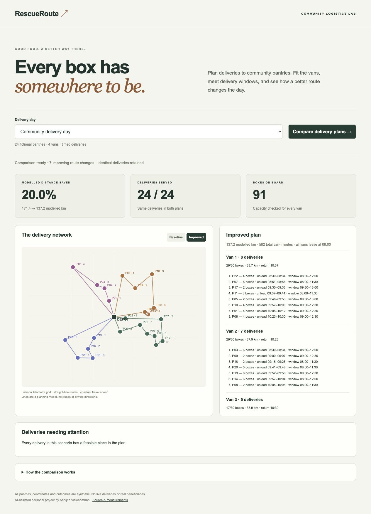

# RescueRoute — Community food delivery planner

**Get donated food to community pantries with fewer modelled kilometres, while respecting the vans and the clock.**

RescueRoute is a new AI-assisted personal project by Abhijith Viswanathan, built in October 2026. It turns a small delivery day into an inspectable plan: which van visits each pantry, how many boxes it carries, when unloading starts and finishes, and whether the driver can return within the shift. It compares a nearest-feasible baseline with a route-improvement heuristic and includes a small exact brute-force reference.

All pantries, locations, inventory and outcomes are fictional. This is a planning prototype, not a record of nonprofit deployment or internship work.



## What a coordinator can do

1. Choose a fictional delivery day: ordinary demand, a shorter volunteer shift, or a capacity shortage.
2. Compare two plans serving exactly the same deliveries.
3. Switch between the baseline and improved route network.
4. Inspect each van's boxes, stop sequence, unloading schedule and depot return.
5. See deliveries that remain unassigned and the reason; the application never quietly drops them to improve a score.

The browser dashboard has a route diagram, distance comparison, per-vehicle schedules, accessible status/error feedback and a mobile layout. Route lines use a fictional kilometre grid, not a street map.

## Run locally

Requires Python 3.12.

```sh
python3.12 -m venv .venv
.venv/bin/python -m pip install -r requirements-dev.txt
.venv/bin/python app.py
```

Open `http://127.0.0.1:8081`. No cloud account, API key or external map service is needed. SQLite creates `var/plans.sqlite` locally. Optional `RESCUE_DB` and `PORT` environment variables change the database path and local port; `.env` is an example only and is not automatically loaded.

For a controlled WSGI test:

```sh
.venv/bin/python -m gunicorn --workers 1 --threads 4 --bind 127.0.0.1:8081 app:app
```

## How it works


### 1. A practical, constrained baseline

The baseline is not deliberately delayed or scrambled. It picks the nearest feasible remaining pantry for each van. A candidate is allowed only if the van has enough box capacity, unloading can finish inside the pantry's window, and the van can still return to the depot before its shift ends. Ties use stable IDs for repeatability.

Each van starts at one depot at 08:00 with all of its route's boxes already loaded. Time-window values are minutes after that start. This is a distribution scenario; it does not model pickups along the route or moving goods between vans.

### 2. Improve the route without changing the job

The optimizer examines two move types:

- **2-opt:** reverse a segment of one route to remove unnecessary travel.
- **Relocation:** move a pantry from one van's sequence into another feasible position, potentially on another van.

Each candidate is fully rescheduled. The algorithm accepts the largest feasible distance reduction in a pass and stops after eight accepted moves or when no improving move is found. It preserves the exact set of served deliveries. A shorter distance is never obtained by deleting a stop.

This bounded local search is deterministic and inspectable. It does not guarantee a globally optimal solution. It also does not prove that an unassigned stop is impossible to serve; a different initial assignment could fit it.

### 3. Use brute force where it is small enough to be useful

For one van and at most eight deliveries, `exhaustive.py` checks every ordering and finds the shortest feasible route. Eight stops mean **40,320 permutations**. The reference exists to validate route quality and measure the speed/quality tradeoff of the heuristic. It is deliberately unavailable through the web API so an ordinary request cannot accidentally trigger factorial work.

The exact and heuristic comparisons use identical delivery coordinates, speed, service times and feasibility rules. A fast heuristic must report its distance gap from the exact optimum alongside its runtime advantage.

### 4. Keep the API result repeatable

Plan creation requires an `Idempotency-Key`. The normalized request is hashed and the complete result is stored under that key in SQLite. Retrying an identical request returns the existing result. Reusing the same key for a different scenario returns HTTP 409. A unique database key and transactional insert protect concurrent retries from creating duplicate records.

Planning happens outside the write transaction. Concurrent identical requests can repeat computation, but converge on one saved result. This is durable idempotent storage, not a background job queue or a claim of exactly-once computation.

### 5. Audit independently

`verification.py` independently recomputes route distance, arrival/unloading times, capacity, depot return, stop coverage and before/after identity. It does not call the planner's scheduling function. The benchmark checks every scenario with this auditor, and a test deliberately corrupts a result to ensure the audit detects it.

## Measurements and verification

[Benchmark methodology and results](benchmarks/README.md) · [Raw route comparison](benchmarks/results.json) · [Raw brute-force comparison](benchmarks/brute-force-results.json)

```sh
.venv/bin/python -m pytest -q
.venv/bin/python benchmarks/compare.py
.venv/bin/python benchmarks/brute_force.py
```

The full test suite covers constraint handling, deterministic output, capacity shortages, exact enumeration, route improvement, independent auditing, input validation, persistence, replay, changed-request conflicts and concurrent requests. GitHub Actions runs the same suite.

## Code map

| File | Responsibility |
|---|---|
| `planner.py` | Validation, schedule simulation, nearest-feasible baseline, 2-opt and relocation |
| `exhaustive.py` | Exact single-van reference bounded to eight stops |
| `verification.py` | Independent audit of delivered plan invariants |
| `scenarios.py` | Deterministic, fictional datasets and three demonstration days |
| `app.py` | Flask API, request limits, same-origin check and SQLite idempotency |
| `static/app.js` | Route visualization, scenario selection and comparison views |
| `tests/` | Behavioral, algorithm and API tests |
| `benchmarks/` | Fixed comparison workloads and recorded measurements |

[API examples](docs/API.md) · [Interview and learning walkthrough](LEARNING_GUIDE.md)

## Boundaries and next engineering steps

Distances are Euclidean on a fictional flat grid. There are no roads, traffic, vehicle-specific speeds, refrigeration constraints, driver breaks, loading time, multiple depots or real geocoding. Delivery windows include unloading completion. The model does not translate distance directly into fuel, emissions, money, meals or beneficiary impact.

Inputs are bounded to 40 deliveries and six vans. Saved plans are immutable snapshots, not live inventory reservations. SQLite is appropriate for a local single-host prototype; this version has no login, tenant isolation, rate limiter, plan retention policy or production dispatch guarantees. Origin checks are not authentication. Do not expose it as a public operational service without those controls, TLS, backups and monitoring.

Useful next work: incorporate a road travel-time matrix, compare against a mature routing solver on the same fixtures, add priority-aware assignment and a dispatcher review step, and benchmark the distance/time/quality tradeoff under tighter windows. Each extension needs new measurements, not an extrapolation of the current numbers.

## Contribution

AI generated implementation, tests and documentation under Abhijith's direction. The repository records working behavior and experiments; it does not establish independent coding proficiency. The learning guide supports tracing, reproducing and extending the implementation.

## Connect

[LinkedIn — Abhijith Viswanathan](https://www.linkedin.com/in/abhijith-viswanathan-0a7216436/)
